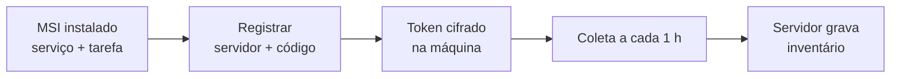

# Instalação silenciosa do Agente Nexus

Como instalar, configurar e remover o agente em massa, sem interação.

## Pacote autoextraível EXE

Execute os comandos em uma sessão elevada ou pela conta SYSTEM. Em PowerShell, `Start-Process -Wait -PassThru` permite verificar o código de saída do setup.

```cmd
nexus-agente-setup.exe /S SERVER=http://192.168.7.19:4545 CODIGO=AAAA-BBBB-CCCC
nexus-agente-setup.exe /S /ATUALIZAR
powershell.exe -NoProfile -NonInteractive -ExecutionPolicy Bypass -File "%ProgramData%\Nexus\desinstalar.ps1" -Silencioso
```

A atualização do EXE preserva o token e o identificador do ativo. O setup também aceita o comando de instalação original na atualização quando o endereço coincide com o já cadastrado. A remoção apaga os arquivos locais do agente e preserva o inventário no servidor. Use `-ManterToken` na desinstalação para reaproveitar o vínculo em uma reinstalação.

O setup retorna `0` quando o serviço foi instalado ou atualizado, inclusive se a vinculação ainda estiver pendente. A opção `/ATUALIZAR` exige uma instalação anterior do pacote EXE. Para estações instaladas por MSI, use o fluxo do MSI abaixo.

---

## Antes de começar

| Item | |
|---|---|
| **Pacote** | `dist\NexusAgente.msi` (~368 KB) |
| **Requisitos** | Windows 10 ou 11, .NET Framework 4.0+, administrador |
| **Servidor** | Nexus 3.70.0 ou superior |

> **O agente exige elevação** (manifesto `requireAdministrator`). Por isso o
> pacote precisa ser executado por uma conta administradora ou por SYSTEM.

---

## 1. Instalar

### Comando básico

```cmd
msiexec /i NexusAgente.msi /qn
```

### Com log (recomendado para diagnóstico)

```cmd
msiexec /i NexusAgente.msi /qn /l*v "%TEMP%\nexus-instalacao.log"
```

### O que é instalado

```
C:\Program Files\Nexus\Agente\agente.exe
```

E criado:

| | |
|---|---|
| **Serviço** | `NexusAgente` — automático, inicia na instalação |
| **Tarefa agendada** | `Nexus Agente` — logon, nível mais alto (sem UAC) |
| **Registro** | `HKLM\SOFTWARE\Microsoft\Windows\CurrentVersion\Uninstall\NexusAgente` |
| **Menu Iniciar** | `Nexus → Nexus Agente` |

### Opções úteis do msiexec

| Parâmetro | Efeito |
|---|---|
| `/qn` | sem interface |
| `/qb` | barra de progresso básica |
| `/l*v arquivo.log` | log detalhado |
| `/norestart` | não reiniciar |
| `REBOOT=ReallySuppress` | impede reinício em qualquer caso |

**Nenhuma propriedade pública é aceita.** O MSI não recebe endereço do servidor
nem código de instalação — veja a seção 2.

---

## 2. Configurar (o passo que o MSI não faz)

> **⚠️ Limitação importante**
>
> O MSI **instala** o agente, mas **não o configura**. A configuração é feita
> na bandeja, no primeiro uso: o ícone aparece e abre a tela pedindo servidor
> e código.
>
> **Isso não escala para 3.000 máquinas sem uma etapa extra.** Veja abaixo
> como automatizar.

### Por que não dá para colocar o token no pacote

O token da máquina é cifrado com **DPAPI de escopo de máquina**. Ele só é
decifrável **na própria máquina** que o gerou — preparar o arquivo de
configuração em outro computador e copiar não funciona.

**Cada máquina precisa executar o registro uma vez**, porque é ela que recebe
e cifra o seu token.

### A etapa extra: registrar por script

Depois do `msiexec`, rode o registro com um código de instalação válido:

```cmd
"C:\Program Files\Nexus\Agente\agente.exe" registrar ^
   --servidor http://192.168.7.19:4545 ^
   --codigo AAAA-BBBB-CCCC
```

**Códigos de instalação** são gerados em **Administração → Agente Nexus** no
painel, com validade e limite de usos.

| Cenário | Usos | Validade |
|---|---|---|
| Uma máquina | 1 | 1 dia |
| Implantação em lote | número de máquinas + 10% | 7 dias |
| Teste | 1 | 1 dia |

> **O código não fica guardado na máquina.** Ele é trocado pelo token e
> descartado. Só o token persiste, cifrado.

### Instalação completa em um comando

```cmd
msiexec /i NexusAgente.msi /qn /l*v C:\Windows\Temp\nexus.log ^
 && "C:\Program Files\Nexus\Agente\agente.exe" registrar --servidor http://192.168.7.19:4545 --codigo AAAA-BBBB-CCCC
```

**Exit code do registro:**

| Código | Significado |
|---|---|
| `0` | registrado |
| `1` | falha grave (sem permissão, servidor inacessível) |
| `3` | **pendente** — código guardado, o serviço tenta de novo sozinho |

**O código 3 não é erro.** A máquina entra em espera e se registra quando o
servidor estiver acessível ou quando o ativo existir.

---

## 3. Implantação por GPO

### Passo a passo

**1.** Copie o `NexusAgente.msi` para um compartilhamento de rede acessível
por **SYSTEM** nas estações:

```
\\servidor\deploy$\NexusAgente.msi
```

**2.** No GPMC, crie uma GPO e vincule ao OU das estações.

**3.** `Configuração do Computador → Políticas → Configurações de Software →
Instalação de Software → Novo → Pacote`

**4.** Escolha **Avançado** e marque **"Ignorar linguagem"** se o pacote
reclamar de idioma.

**5.** Em **Implantação**, escolha **Atribuído**.

**Isso instala o serviço.** A configuração (servidor + código) precisa da
etapa 2 — um **script de inicialização** na mesma GPO:

```
Configuração do Computador → Políticas → Configurações do Windows → Scripts →
Inicialização → Adicionar
```

Conteúdo do `.bat`:

```bat
@echo off
setlocal

set AGENTE=C:\Program Files\Nexus\Agente\agente.exe
set SERVIDOR=http://192.168.7.19:4545
set CODIGO=AAAA-BBBB-CCCC

rem Já configurado? Não faz nada.
if exist "%ProgramData%\Nexus\agente.json" exit /b 0

"%AGENTE%" registrar --servidor "%SERVIDOR%" --codigo "%CODIGO%"
exit /b 0
```

> **O `if exist` é essencial.** Sem ele, o script reconfigura a máquina a cada
> reinício, consumindo usos do código e criando tokens órfãos.

### ⚠️ Segurança do código na GPO

O código fica **legível no script da GPO**. Quem tiver acesso ao
compartilhamento pode registrá-lo em outras máquinas.

**Mitigações:**

- validade curta (a janela da implantação, não o mês)
- limite de usos próximo do número real de máquinas
- **revogar o código** em Agente Nexus assim que a implantação terminar
- o código **só registra** — não lê inventário, não altera ativo

---

## 4. Implantação por SCCM / Intune

### SCCM

| Campo | Valor |
|---|---|
| **Tipo** | Windows Installer (`*.msi`) |
| **Programa** | `msiexec /i "NexusAgente.msi" /qn` |
| **Detecção** | Chave de registro `HKLM\SOFTWARE\Microsoft\Windows\CurrentVersion\Uninstall\NexusAgente` |
| **Contexto** | Sistema (não usuário) |

**O contexto "Sistema" é obrigatório** — o MSI cria serviço e tarefa agendada.

### Intune

Empacote como **Win32 app** usando o [IntuneWinAppUtil], com:

```cmd
Instalação:       msiexec /i "NexusAgente.msi" /qn
Desinstalação:    msiexec /x "{GUID do produto}" /qn
Detecção:         chave de registro acima
```

---

## 5. Verificar

```powershell
# 1. o arquivo está no lugar
Test-Path "C:\Program Files\Nexus\Agente\agente.exe"

# 2. o serviço existe e está rodando
Get-Service NexusAgente

# 3. a tarefa de logon existe
schtasks /query /tn "Nexus Agente"

# 4. aparece em Aplicativos e recursos
Get-ItemProperty "HKLM:\SOFTWARE\Microsoft\Windows\CurrentVersion\Uninstall\NexusAgente" |
    Select-Object DisplayName, DisplayVersion, InstallLocation

# 5. a máquina se registrou?
Test-Path "C:\ProgramData\Nexus\agente.json"
```

**Se o item 5 for `False`**, a configuração (etapa 2) não rodou.

---

## 6. Desinstalar

### Comando

```cmd
msiexec /x NexusAgente.msi /qn
```

**Ou pelo GUID do produto** (não precisa do arquivo):

```cmd
msiexec /x "{GUID}" /qn
```

**O que é removido:**

- arquivo e pasta de instalação
- serviços `NexusAgente`
- tarefa agendada
- entrada de Aplicativos e recursos
- atalho do Menu Iniciar

**O que NÃO é removido:**

| | Por quê |
|---|---|
| `C:\ProgramData\Nexus\` (configuração e token) | o MSI não gerencia — o caminho tem `Permanent="yes"` |

**Para remover também:**

```powershell
Remove-Item "C:\ProgramData\Nexus" -Recurse -Force
Remove-Item "$env:LOCALAPPDATA\Nexus" -Recurse -Force
```

> **O ativo no servidor continua existindo.** Para o servidor parar de aceitar
> a máquina, revogue o token em **Administração → Agente Nexus**.

### A senha de fechamento não bloqueia a desinstalação

O `msiexec /x` não passa pelo agente — o Windows Installer remove os arquivos
por conta própria.

**Por desenho.** A senha protege o fechamento pelo ícone, não a remoção.

---

## 7. Problemas comuns

### `msiexec` retorna 1603

Falha genérica. **O log diz o motivo:**

```powershell
Select-String -Path "$env:TEMP\nexus-instalacao.log" -Pattern "Error|error"
```

**Causas frequentes:** sem elevação, serviço com o mesmo nome já existente,
arquivo em uso.

### Retorna 1618

Outra instalação em andamento. Aguarde ou reinicie.

### O serviço não inicia

```powershell
Get-EventLog -LogName Application -Source NexusAgente -Newest 10
```

**Causa comum:** agente não configurado. Sem servidor, ele ainda sobe — mas
registra erro no ciclo.

### A tarefa agendada não existe

As custom actions usam `Return="ignore"` — falham em silêncio.

**Verifique manualmente:**

```powershell
schtasks /create /f /tn "Nexus Agente" ^
   /tr "C:\Program Files\Nexus\Agente\agente.exe" ^
   /sc onlogon /rl highest
```

**Se isso funcionar e o MSI não criou**, rode o MSI com log e procure por
`CriarTarefaLogon`.

### O ícone não aparece depois de instalar

**É esperado.** O MSI não abre janela na sessão do usuário — quem inicia é a
tarefa de logon.

**Saídas:**

- sair e entrar novamente no Windows
- abrir pelo Menu Iniciar → `Nexus Agente`

### A senha de fechamento não é pedida

O agente instalado é anterior à versão com validação de senha. **Reinstale.**

---

## 8. Números

**Com 3.000 máquinas:**

| | |
|---|---|
| Instalações | 3.000 |
| Códigos necessários | 1 de frota (3.500 usos) ou vários por lote |
| Envios/dia (1 h) | 72.000 |
| Requisições/minuto | 50 |
| Pico por estação | ~1 s por máquina |

**O gargalo não é o servidor** — é a distribuição do código de instalação.

---

## 9. Resumo



**O MSI faz metade. A outra metade é o `registrar` — e não há como embutir,
porque o token nasce por máquina.**

---

*Última atualização: versão 1.0.0 do agente.*
