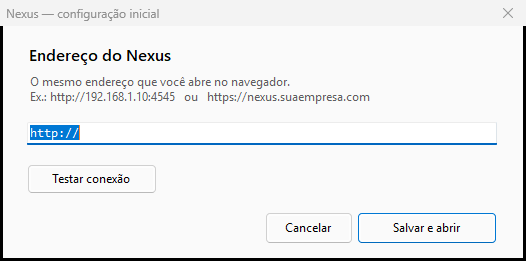

# Nexus para Windows

O Nexus como programa de janela própria — o mesmo sistema que roda no
navegador, sem a barra de endereço.



---

## O que este programa é

**Um hospedeiro da aplicação web**, e não uma segunda interface.

```
┌─────────────────────────────────────────┐
│  Nexus.exe                              │
│  ┌───────────────────────────────────┐  │
│  │  WebView2 (motor do Edge)         │  │
│  │  ┌─────────────────────────────┐  │  │
│  │  │  A MESMA PWA do navegador   │  │  │
│  │  │  servida pelo gateway Nexus │  │  │
│  │  └─────────────────────────────┘  │  │
│  └───────────────────────────────────┘  │
└─────────────────────────────────────────┘
```

### Por que assim, e não uma interface nativa

O sistema tem 19 módulos e 34 telas. Reescrever isso em WinForms significaria
**duas interfaces para manter**: toda correção feita na web teria de ser
refeita aqui, e as duas divergiriam na primeira semana.

Hospedando a mesma aplicação, a paridade é **por construção**: não existe tela
"que ficou para trás" porque é a mesma tela.

### O que o programa acrescenta

| | |
|---|---|
| **Janela própria** | sem barra de endereço, sem abas, sem distração |
| **Lembra o servidor** | configura uma vez; as próximas aberturas vão direto |
| **Atalho** | pode ficar na área de trabalho ou no menu iniciar |
| **Sessão preservada** | `localStorage` fica na pasta de dados do WebView2 |
| **Câmera liberada** | o leitor de QR funciona sem prompt do navegador |

### Os dois coexistem

O programa **não substitui** o acesso pelo navegador. Os dois falam com o
mesmo servidor, usam a mesma API e veem os mesmos dados. É o mesmo sistema por
duas portas.

---

## Requisitos

**Na máquina de quem usa:**

| | |
|---|---|
| Windows 10 ou 11 (x64) | |
| **WebView2 Runtime** | vem com o Microsoft Edge — normalmente já está instalado |

Se faltar o WebView2, o programa avisa e indica onde baixar. **Não é preciso
instalar o .NET nem nada além disso**: o executável usa o .NET Framework 4.8,
que faz parte do Windows.

**Na máquina de quem compila:**

| | |
|---|---|
| `csc.exe` (compilador do .NET Framework) | `C:\Windows\Microsoft.NET\Framework64\v4.0.30319\` |
| DLLs do WebView2 | já estão em `lib/` |

---

## Compilar

```powershell
cd Software
.\build.ps1
```

Saída em `bin\`:

```
bin\
├── Nexus.exe                          23 KB
├── Microsoft.Web.WebView2.Core.dll    687 KB
├── Microsoft.Web.WebView2.WinForms.dll 38 KB
└── WebView2Loader.dll                 190 KB
```

```powershell
.\build.ps1 -Executar    # compila e abre
```

> **Não há instalador.** A pasta `bin\` é autossuficiente: copie para onde
> quiser e execute. Foi uma escolha deliberada — instalador exige elevação,
> cria entradas no registro e dificulta a atualização. Uma pasta copiada
> resolve.

---

## Configurar

Na primeira execução, a janela pergunta **uma coisa**: o endereço do gateway.

```
┌─────────────────────────────────────────────────┐
│  Endereço do Nexus                              │
│                                                 │
│  O mesmo endereço que você abre no navegador.   │
│  Ex.: http://192.168.1.10:4545                  │
│       https://nexus.suaempresa.com              │
│                                                 │
│  [ http://192.168.1.10:4545          ]          │
│                                                 │
│  [ Testar conexão ]  Conectado. Servidor OK.    │
│                                                 │
│                    [ Cancelar ] [ Salvar e abrir]│
└─────────────────────────────────────────────────┘
```

**"Testar conexão"** consulta o `/health` do servidor e diz o que houve:
conectou, respondeu erro, não respondeu em 8 segundos, ou não parece um Nexus.

**Por que só isto:** o OCS, o banco e o Active Directory são configuração do
**servidor**. O cliente nunca fala com eles — o gateway é o único endereço de
que ele precisa.

### Onde a configuração fica

```
%APPDATA%\Nexus\config.ini
```

```ini
servidor=http://192.168.1.10:4545
largura=1280
altura=860
maximizado=0
```

Apagar o arquivo volta à tela de configuração. Trocar de servidor depois:
**Arquivo → Trocar de servidor…**

---

## Menu

| Item | Atalho | |
|---|---|---|
| Recarregar | **F5** | recarrega a aplicação |
| Ferramentas do desenvolvedor | **F12** | abre o DevTools do Edge |
| Trocar de servidor… | | reabre a configuração |
| Sobre | | versão do servidor e do WebView2 |

---

## Limitações conhecidas

**1. A pasta de dados pode ficar travada.**

O WebView2 trava a pasta enquanto algum processo dele estiver vivo. Se uma
execução anterior ficou pendurada, a próxima falha com
`0x800700AA — Recurso solicitado em uso`.

**O que o programa faz:** o nome da pasta carrega a data de compilação
(`WebView2-202610242323`), então uma pasta emperrada não bloqueia uma versão
nova. Se nem assim der, tenta `%TEMP%`. Se as duas falharem, deixa o WebView2
escolher — e ele usa `Nexus.exe.WebView2`, ao lado do executável.

> **⚠️ Observado no ambiente de teste:** as duas primeiras opções foram
> negadas (`Acesso negado` em `%LOCALAPPDATA%\Nexus` e em `%TEMP%`), e o
> aplicativo seguiu para o caminho padrão, onde funciona. **A causa do
> "Acesso negado" não foi determinada**: a ACL da pasta está correta e um
> programa .NET comum cria a mesma pasta sem problema. Como o caminho padrão
> fica **ao lado do executável**, colocar o programa em `Program Files`
> provavelmente vai falhar — prefira uma pasta no perfil do usuário
> (`%LOCALAPPDATA%\Programs\Nexus`, por exemplo).

**2. Um processo por vez.**

O programa usa um `Mutex`. Abrir duas vezes traz a mensagem "já está aberto".
Duas instâncias disputariam a mesma pasta de dados e poderiam corromper o
cache.

**3. Sem ícone próprio.**

Usa o ícone genérico de aplicativo. Um `.ico` com a marca do Nexus pode ser
adicionado em `build.ps1` com `/win32icon:`.

**4. Sem assinatura de código.**

Compilado localmente, sem certificado. Em ambiente com GPO restritiva, o
SmartScreen ou o antivírus pode alertar na primeira execução. Para distribuir
em escala, o binário precisa ser assinado.

---

## Arquivos

```
Software/
├── README.md              este arquivo
├── build.ps1              compila com csc.exe
├── capturar.ps1           captura a janela (diagnóstico)
├── captura.png            imagem acima
├── lib/                   DLLs do WebView2 (3 arquivos)
├── src/
│   ├── Program.cs         entrada, instância única, registro de falhas
│   ├── Configuracao.cs    config.ini, normalização de URL, pasta de dados
│   ├── ConfigForm.cs      tela de configuração com teste de conexão
│   └── MainForm.cs        janela, WebView2, menu, permissões
└── bin/                   saída da compilação
```

---

## Registro de falhas

Um programa `winexe` não tem console: uma exceção não tratada fecha a janela
sem dizer nada. O programa escreve em dois lugares:

| Onde | O quê |
|---|---|
| `%APPDATA%\Nexus\erro.log` | falhas de qualquer thread, com pilha |
| `bin\erro.txt` | falhas ao abrir, ao lado do executável |

E, quando a janela não abre, **o motivo aparece na própria tela** — não só
"não foi possível abrir".

> **Ainda não confirmado:** o `erro.log` em `%APPDATA%` não foi visto sendo
> criado no ambiente de teste, embora o mesmo código funcione num programa
> separado. O `bin\erro.txt` funciona e foi o que permitiu diagnosticar o
> `0x800700AA`. Vale investigar quando houver tempo.
